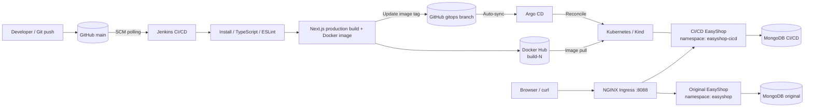

# EasyShop | End-to-End DevOps CI/CD and GitOps on Local Kubernetes


## Contents

1. [Project overview](#1-project-overview)
2. [Architecture and delivery flow](#2-architecture-and-delivery-flow)
3. [Verified environment and access](#3-verified-environment-and-access)
4. [Prerequisites and installation](#4-prerequisites-and-installation)
5. [Clone and inspect the repository](#5-clone-and-inspect-the-repository)
6. [Create the local Kubernetes cluster](#6-create-the-local-kubernetes-cluster)
7. [Deploy the original application](#7-deploy-the-original-application)
8. [Deploy the separate CICD application](#8-deploy-the-separate-cicd-application)
9. [Configure NGINX Ingress](#9-configure-nginx-ingress)
10. [Install and configure Jenkins](#10-install-and-configure-jenkins)
11. [Configure Docker Hub and GitHub access](#11-configure-docker-hub-and-github-access)
12. [Install Argo CD and enable GitOps](#12-install-argo-cd-and-enable-gitops)
13. [CI/CD workflow and release procedure](#13-cicd-workflow-and-release-procedure)
14. [Validation and smoke tests](#14-validation-and-smoke-tests)
15. [Troubleshooting playbook](#15-troubleshooting-playbook)
16. [Security, limitations and future improvements](#16-security-limitations-and-future-improvements)
17. [Useful day-two commands](#17-useful-day-two-commands)

---

## 1. Project overview

EasyShop is a Next.js 14 / TypeScript e-commerce application backed by MongoDB. This project builds a **local, reproducible DevOps delivery platform** around it, rather than claiming to be a public cloud production deployment.

The project demonstrates:

- Source control and branch-based GitOps with GitHub.
- Jenkins SCM-triggered CI checks (`npm ci`, TypeScript, ESLint).
- Multi-stage Docker image creation, production Next.js build, and Docker Hub publishing.
- Jenkins updating a Kubernetes manifest in a dedicated `gitops` branch.
- Argo CD continuously reconciling Kubernetes workloads from that branch.
- A separate original application and CI/CD-managed application, each with its own MongoDB workload.
- NGINX Ingress HTTP access and verification with `curl`.

**Design boundary:** Jenkins builds and publishes artifacts and updates Git. **Argo CD**, not Jenkins, applies the GitOps-managed Kubernetes release.

## 2. Architecture and delivery flow




**Delivery sequence:** `git push main` → Jenkins SCM polling → install and checks → Docker build → push `johncorner158/easyshop-ci:build-N` → commit image tag to `gitops` → Argo CD auto-sync → Kubernetes rolling update → application health verification.

### Separation of responsibilities

| Layer | Technology | Responsibility |
|---|---|---|
| Application | Next.js, TypeScript | Web UI and API routes |
| Data | MongoDB | Persistent application data |
| Source control | GitHub | `main` code and `gitops` desired state |
| CI | Jenkins | Test, build, publish, update GitOps manifest |
| Artifact registry | Docker Hub | Versioned container images |
| Orchestration | Kind + Kubernetes | Deployments, Services, Pods, database |
| Ingress | ingress-nginx | Host-based HTTP routing |
| CD | Argo CD | GitOps reconciliation and self-healing |

## 3. Verified environment and access

The following are **actual lab values**, not generic defaults. Change them for another computer or network.

| Setting | Verified value |
|---|---|
| Ubuntu host | `workerNode1` |
| Linux account | `adminx` (some administrative commands run as root) |
| Host LAN IP | `192.168.68.110` |
| Repository directory | `/home/adminx/Downloads/EasyShop/easyshop-devops` |
| GitHub repository | `git@github.com:harisamjad0158/easyshop-devops_localhost.git` |
| Git branches | `main` (source), `gitops` (deployment state) |
| Kind cluster | `easyshop-cluster` |
| kubectl context | `kind-easyshop-cluster` |
| Original namespace / deployment | `easyshop` / `easyshop` (1 replica) |
| CI/CD namespace / deployment | `easyshop-cicd` / `easyshop-cicd` (2 replicas) |
| Original database pod | `easyshop/mongodb-0` |
| CI/CD database pod | `easyshop-cicd/mongodb-cicd-0` |
| Jenkins job | `EasyShop-CI-CD` |
| Docker image | `johncorner158/easyshop-ci:build-12` |
| Argo CD Application | `argocd/easyshop-cicd` |
| Argo CD source | `gitops` branch, `kubernetes/gitops` directory |
| GitOps manifest | `kubernetes/gitops/deployment.yaml` |

**Lab URLs:**

- Original application: `http://192.168.68.110:8088/`
- CI/CD application: `http://cicd.easyshop.local:8088/` (requires hosts-file entry)
- Jenkins: `http://192.168.68.110:8080/job/EasyShop-CI-CD/`
- Argo CD: `https://192.168.68.110:8090/` **only while the appropriate port-forward is running**.

These are **private LAN URLs**, not public internet endpoints.

## 4. Prerequisites and installation

Use an Ubuntu host with enough CPU, RAM, and disk space for a multi-node Docker/Kind environment, two MongoDB instances, Jenkins, and Argo CD. **Check resource availability first**.

```bash
# Ubuntu prerequisites and utilities
sudo apt-get update
sudo apt-get install -y ca-certificates curl git jq openssh-client gnupg

# Inspect the system before installing or starting components
uname -a
free -h
df -h
command -v docker || true
command -v kind || true
command -v kubectl || true
command -v helm || true
command -v java || true
```

### Docker Engine

Install Docker Engine using the official Ubuntu instructions for your release: https://docs.docker.com/engine/install/ubuntu/ . Then verify:

```bash
sudo systemctl enable --now docker
sudo docker version
sudo docker info
```

For non-root Docker usage, optionally add the account to the `docker` group, then **log out and back in**. Membership grants root-equivalent Docker access; use only on a trusted lab machine.

```bash
sudo usermod -aG docker adminx
id adminx
```

### Kind, kubectl and Helm

Use the official installation instructions for current binaries (and pin tested versions in a production-grade environment):

- Kind: https://kind.sigs.k8s.io/docs/user/quick-start/
- kubectl: https://kubernetes.io/docs/tasks/tools/install-kubectl-linux/
- Helm: https://helm.sh/docs/intro/install/

```bash
kind version
kubectl version --client
helm version
```

**Why:** Docker runs Kind nodes; Kind creates a local Kubernetes cluster; `kubectl` manages workloads; Helm installs platform services.

## 5. Clone and inspect the repository

```bash
mkdir -p /home/adminx/Downloads/EasyShop
cd /home/adminx/Downloads/EasyShop

# Clone as the account that owns the GitHub SSH key
sudo -H -u adminx git clone \
  git@github.com:harisamjad0158/easyshop-devops_localhost.git \
  easyshop-devops

cd easyshop-devops
git branch -a
git log -1 --oneline
ls -la
find . -maxdepth 3 \( -name '*kind*.yaml' -o -name '*kind*.yml' -o -name 'Jenkinsfile' -o -name 'Dockerfile' \) -print
find kubernetes -maxdepth 4 -type f -print | sort
```

**Existing installation:** If the repository directory already exists, do not clone over it. Use `git status`, `git remote -v`, and `git fetch` before deciding how to update it. **Do not run `git reset --hard`** on a working project.

The original project contains application and Kubernetes assets. The exact path of every original manifest and Kind config is **not independently verified in this README**; use the discovery commands above instead of assuming a filename.

## 6. Create the local Kubernetes cluster

> Perform this step **only on a fresh installation**. Do not recreate the already-running `easyshop-cluster`.


### 6.1 Check for existing clusters

```bash
kind get clusters
kubectl config get-contexts
```

### 6.2 Create a Kind configuration for a new lab

This is a **reference configuration** compatible with an ingress listener on host port 8088. It is not claimed to be byte-for-byte identical to the original project's Kind file.

```bash
cat > /tmp/easyshop-kind-config.yaml <<'YAML'
kind: Cluster
apiVersion: kind.x-k8s.io/v1alpha4
nodes:
  - role: control-plane
    kubeadmConfigPatches:
      - |
        kind: InitConfiguration
        nodeRegistration:
          kubeletExtraArgs:
            node-labels: "ingress-ready=true"
    extraPortMappings:
      - containerPort: 80
        hostPort: 8088
        protocol: TCP
      - containerPort: 443
        hostPort: 8443
        protocol: TCP
  - role: worker
YAML

kind create cluster --name easyshop-cluster --config /tmp/easyshop-kind-config.yaml
kubectl config use-context kind-easyshop-cluster
kubectl get nodes -o wide
kubectl get pods -A
```

**Why:** The extra port mapping forwards traffic from Ubuntu `:8088` to the Kind control-plane node's port 80. An ingress controller must still be installed to route it.

**Existing cluster check:**

```bash
kubectl config use-context kind-easyshop-cluster
kubectl get nodes
kubectl get namespaces
```

## 7. Deploy the original application

The verified original environment uses namespace `easyshop`, deployment `easyshop` (1/1), and MongoDB pod `mongodb-0`. Preserve this environment independently of the CI/CD-managed release.

### 7.1 Inspect existing manifests and workloads

```bash
cd /home/adminx/Downloads/EasyShop/easyshop-devops
find kubernetes -maxdepth 4 -type f -print | sort
kubectl get namespace easyshop
kubectl get deployments,services,statefulsets,pods,pvc -n easyshop
kubectl get ingress -A
```

### 7.2 Apply original manifests (fresh installation)

First identify the **original application manifests** in the repository and check their `metadata.namespace` and resource names. Then apply the relevant namespace, database, application, Service, and ingress manifests **in that order**. Do **not** indiscriminately apply `kubernetes/gitops` to the original namespace.

```bash
# Example command structure; replace paths with discovered real paths:
# kubectl apply -f <original-namespace-manifest>
# kubectl apply -f <original-mongodb-manifest>
# kubectl apply -f <original-app-deployment-manifest>
# kubectl apply -f <original-service-manifest>
# kubectl apply -f <original-ingress-manifest>

kubectl rollout status deployment/easyshop -n easyshop --timeout=180s
kubectl get pods,services -n easyshop
```

**Why:** Kubernetes objects need correct namespaces, matching Service selectors, valid image references, and a reachable MongoDB connection string. This README deliberately does not invent original manifest filenames or database credentials.

## 8. Deploy the separate CI/CD application

The verified CI/CD namespace is `easyshop-cicd`. The **GitOps branch is authoritative** for its Kubernetes release; Argo CD should manage it after bootstrap.

### 8.1 Create the namespace

```bash
kubectl create namespace easyshop-cicd --dry-run=client -o yaml | kubectl apply -f -
kubectl get namespace easyshop-cicd
```

### 8.2 Inspect the GitOps manifests

```bash
cd /home/adminx/Downloads/EasyShop/easyshop-devops
sudo -H -u adminx git ls-remote origin refs/heads/gitops

# View without altering the current working branch
sudo -H -u adminx git show origin/gitops:kubernetes/gitops/deployment.yaml 2>/dev/null \
  || echo 'Fetch gitops branch first: sudo -H -u adminx git fetch origin gitops'

kubectl get deployment easyshop-cicd -n easyshop-cicd -o wide
kubectl get pods,services,statefulsets,pvc -n easyshop-cicd
```

On a new cluster, install Argo CD (section 12) and create its Application to deploy the GitOps directory. Any **database StatefulSet, PVC, Secrets, and Service** that are not included in the GitOps directory must be bootstrapped separately using the actual repository manifests. Confirm database resources exist before expecting the app to become ready.

**Do not copy production MongoDB secrets into the README or commit them to Git.**

## 9. Configure NGINX Ingress

### 9.1 Install ingress-nginx for Kind

Use the upstream Kind-specific provider manifest, then wait for the controller:

```bash
kubectl apply -f \
  https://raw.githubusercontent.com/kubernetes/ingress-nginx/main/deploy/static/provider/kind/deploy.yaml

kubectl wait --namespace ingress-nginx \
  --for=condition=Ready pod \
  --selector=app.kubernetes.io/component=controller \
  --timeout=300s

kubectl get pods,services -n ingress-nginx
kubectl get ingress -A
```

**Compatibility note:** Controller manifests and Kind integration can change across releases. For a reproducible setup, pin a reviewed ingress-nginx release rather than using `main`. If the controller is healthy but `:8088` does not work, verify the Kind port mapping and controller placement/labels.

### 9.2 Windows hosts-file entry

On the Windows computer used to access the CI/CD site, open Notepad **as Administrator**, edit:

```text
C:\Windows\System32\drivers\etc\hosts
```

Add:

```text
192.168.68.110 cicd.easyshop.local
```

Then verify from Windows PowerShell:

```powershell
ipconfig /flushdns
Test-NetConnection 192.168.68.110 -Port 8088
curl.exe -I http://cicd.easyshop.local:8088/
```

### 9.3 Check host-based routing from Ubuntu

```bash
curl --noproxy '*' -sS -o /dev/null -w 'Original: %{http_code}\n' \
  http://127.0.0.1:8088/

curl --noproxy '*' -sS -H 'Host: cicd.easyshop.local' \
  -o /dev/null -w 'CI/CD: %{http_code}\n' \
  http://127.0.0.1:8088/
```

**Why:** Both applications share an ingress entry point. The Host header tells ingress which application should receive the request.

## 10. Install and configure Jenkins

Jenkins runs as a **systemd service on Ubuntu** in the verified lab, with its data in `/var/lib/jenkins`. Install using the official Jenkins Ubuntu/Debian guide: https://www.jenkins.io/doc/book/installing/linux/ . Use a supported Java runtime and pin Jenkins/plugins for your environment.

```bash
sudo systemctl enable --now jenkins
sudo systemctl status jenkins --no-pager
sudo systemctl is-active jenkins
sudo ss -ltnp | grep ':8080' || true
```

For a first installation, retrieve the initial admin password **locally** (never commit or publish it):

```bash
sudo cat /var/lib/jenkins/secrets/initialAdminPassword
```

Open `http://192.168.68.110:8080/`, complete the setup wizard, and install the plugins required by the Jenkinsfile. Common requirements include **Pipeline**, **Git**, **GitHub integration**, **Credentials Binding**, and **Docker Pipeline**. Confirm actual dependencies in **Manage Jenkins → Plugins**.

### 10.1 Create the job

1. **New Item** → name `EasyShop-CI-CD` → **Pipeline**.
2. Under **Pipeline**, select **Pipeline script from SCM**.
3. SCM: **Git**; repository: `git@github.com:harisamjad0158/easyshop-devops_localhost.git`.
4. Branch: `*/main`; Script Path: `Jenkinsfile`.
5. Select a Git SSH credential if the Jenkins service cannot otherwise authenticate.
6. Under **Build Triggers**, configure **Poll SCM** with `H/5 * * * *` (the lab's configured interval).
7. Save and select **Build Now** for initial validation.

The successful Build #12 was **started by an SCM change**, and Jenkins checked out `67fa38d` from `main`.

### 10.2 Check job and build results

```bash
sudo systemctl is-active jenkins
sudo ls -lt /var/lib/jenkins/jobs/EasyShop-CI-CD/builds/ | head -15

LATEST=$(sudo find /var/lib/jenkins/jobs/EasyShop-CI-CD/builds \
  -mindepth 1 -maxdepth 1 -type d -printf '%f\n' \
  | grep -E '^[0-9]+$' | sort -n | tail -1)

echo "Latest Jenkins build: ${LATEST:-none}"
if [ -n "$LATEST" ]; then
  sudo grep -E '<result>|<building>' \
    "/var/lib/jenkins/jobs/EasyShop-CI-CD/builds/$LATEST/build.xml" | tail -5
fi
```

## 11. Configure Docker Hub and GitHub access

### 11.1 Docker Hub

Create a **scoped Docker Hub access token** with appropriate permissions for repository `johncorner158/easyshop-ci`. Add it in Jenkins Credentials; the Jenkinsfile references a credential that exposes `DOCKER_TOKEN`. **Check the Jenkinsfile for the exact credential ID and Docker username before configuring.**

The pipeline performs the equivalent of:

```bash
# Illustrative local commands (do not put passwords in shell history)
docker build -t easyshop-ci:build-12 .
docker tag easyshop-ci:build-12 johncorner158/easyshop-ci:build-12
# Authenticate securely with a scoped token using --password-stdin
docker push johncorner158/easyshop-ci:build-12
```

Do not manually reuse `build-12` for a different release. Jenkins generates build-numbered image tags.

### 11.2 GitHub SSH identity

The local `adminx`, `root`, and `jenkins` accounts can have **different SSH keys and home directories**. A successful push as `adminx` does not imply root can authenticate.

```bash
sudo -H -u adminx ssh -T git@github.com
sudo -H -u adminx git ls-remote \
  git@github.com:harisamjad0158/easyshop-devops_localhost.git \
  refs/heads/main
```

For Jenkins to push to `gitops`, configure a **dedicated GitHub deploy key with write access** (or equivalent least-privilege GitHub credential), then test SSH access as the Jenkins service account without printing private keys.

**Do not** paste private keys, Docker tokens, Jenkins passwords, or Kubernetes Secrets into build logs or documentation.

## 12. Install Argo CD and enable GitOps

The verified installation used **Helm**, release name `argocd`, namespace `argocd`. For a new installation:

```bash
kubectl create namespace argocd --dry-run=client -o yaml | kubectl apply -f -
helm repo add argo https://argoproj.github.io/argo-helm
helm repo update
helm upgrade --install argocd argo/argo-cd -n argocd
kubectl get pods -n argocd
kubectl get services -n argocd
```

**Production note:** Pin the chart version and maintain a reviewed values file; the above is a generic lab installation, not a reconstruction of the original exact Helm settings.

### 12.1 Argo CD Application definition

This is a **reference bootstrap Application** based on the verified GitOps branch and path. Review the manifests before applying; on the existing cluster, **do not overwrite the working Application**.

```yaml
apiVersion: argoproj.io/v1alpha1
kind: Application
metadata:
  name: easyshop-cicd
  namespace: argocd
spec:
  project: default
  source:
    repoURL: git@github.com:harisamjad0158/easyshop-devops_localhost.git
    targetRevision: gitops
    path: kubernetes/gitops
  destination:
    server: https://kubernetes.default.svc
    namespace: easyshop-cicd
  syncPolicy:
    automated:
      prune: false
      selfHeal: true
    syncOptions:
      - CreateNamespace=true
```

**Important:** Argo CD needs read access to this SSH repository. Configure its repository credential in Argo CD first. The existing Application was verified as `Synced / Healthy` with auto-sync self-healing enabled and pruning disabled.

### 12.2 Dashboard access (temporary lab port-forward)

```bash
kubectl port-forward --namespace argocd --address 127.0.0.1 \
  service/argocd-server 8090:443
```

Open `https://127.0.0.1:8090` on the Ubuntu host. For remote access from a Windows workstation, prefer an SSH tunnel:

```powershell
ssh -L 8090:127.0.0.1:8090 adminx@192.168.68.110
```

Then open `https://127.0.0.1:8090` on Windows. The original lab also used `--address 0.0.0.0` for LAN access; **do not expose the Argo CD administrative UI broadly without authentication, TLS, and network restrictions**.

### 12.3 Inspect synchronization

```bash
kubectl get application easyshop-cicd -n argocd
kubectl describe application easyshop-cicd -n argocd
kubectl get deployment easyshop-cicd -n easyshop-cicd \
  -o jsonpath='{.spec.template.spec.containers[*].image}{"\n"}'
```

## 13. CI/CD workflow and release procedure

### 13.1 Verified Jenkins Build #12 stages

| Stage | What it did | Verified outcome |
|---|---|---|
| Checkout | Fetch GitHub `main` at `67fa38d` | Passed |
| Install Dependencies | `npm ci` | Passed |
| TypeScript Check | `npx tsc --noEmit` | Passed |
| Lint | `CI=1 npm run lint` | Passed, no ESLint errors |
| Build Docker Image | `docker build -t easyshop-ci:build-12 .` | Passed; Next.js build compiled |
| Verify / Tag Image | Inspect and tag image | Passed |
| Push Docker Image | Push to `johncorner158/easyshop-ci:build-12` | Passed |
| Update GitOps Manifest | Modify `kubernetes/gitops/deployment.yaml` | Passed |
| Push GitOps Branch | Commit `82c7161` to `gitops` | Passed |
| Argo CD reconciliation | Sync manifest to cluster | Synced / Healthy |

The production Next.js build emitted **nonfatal** errors during prerendering about dynamic server usage and missing MongoDB on `localhost:27017` inside the build container. The build still completed successfully. Review the affected routes for runtime correctness; a green build alone is not an end-to-end feature test.

### 13.2 Normal release procedure

```bash
cd /home/adminx/Downloads/EasyShop/easyshop-devops

# Review exactly what will be committed
git status --short
git diff --check

# Example: stage only a specific, reviewed file
# git add path/to/changed-file
# git commit -m "feat: describe the change"

# Push as the Linux account whose SSH key works
sudo -H -u adminx git push origin main

# Jenkins polls main; check the job and Argo CD afterward
sudo systemctl is-active jenkins
kubectl get application easyshop-cicd -n argocd
kubectl rollout status deployment/easyshop-cicd -n easyshop-cicd --timeout=180s
```

If Jenkins has not yet polled, click **Build Now** once in the Jenkins UI. Wait for **SUCCESS**, then confirm that the `gitops` branch and deployed image tag have changed. **Do not manually change the Kubernetes Deployment image** for routine releases; Argo CD should remain the source of truth.

### 13.3 Verify GitHub branch revisions

```bash
sudo -H -u adminx git ls-remote origin refs/heads/main
sudo -H -u adminx git ls-remote origin refs/heads/gitops
```

At the verified milestone, `main` pointed to `67fa38d` and `gitops` to `82c7161`.

## 14. Validation and smoke tests

### 14.1 Cluster and workload health

```bash
kubectl config use-context kind-easyshop-cluster
kubectl get nodes
kubectl get pods -A
kubectl get deployment easyshop -n easyshop
kubectl get deployment easyshop-cicd -n easyshop-cicd
kubectl get pod mongodb-0 -n easyshop
kubectl get pod mongodb-cicd-0 -n easyshop-cicd
kubectl get application easyshop-cicd -n argocd
```

Expected at the verified milestone: original `1/1`, CI/CD `2/2`, both MongoDB pods `Running`, Argo CD `Synced / Healthy`.

### 14.2 HTTP and API smoke tests

```bash
BASE='http://127.0.0.1:8088'

curl --noproxy '*' -sS --max-time 15 -o /dev/null \
  -w 'Original homepage HTTP: %{http_code}\n' "$BASE/"

curl --noproxy '*' -sS --max-time 15 -H 'Host: cicd.easyshop.local' \
  -o /dev/null -w 'CI/CD homepage HTTP: %{http_code}\n' "$BASE/"

curl --noproxy '*' -sS --max-time 15 -o /dev/null \
  -w 'Original products API HTTP: %{http_code}\n' "$BASE/api/products"

curl --noproxy '*' -sS --max-time 15 -H 'Host: cicd.easyshop.local' \
  -o /dev/null -w 'CI/CD products API HTTP: %{http_code}\n' "$BASE/api/products"

# Inspect response structure without exposing user data
curl --noproxy '*' -fsS --max-time 15 \
  -H 'Host: cicd.easyshop.local' "$BASE/api/products" \
  | jq '{productCount: (.products | length), pagination: .pagination}'
```

Expected: HTTP `200` for both homepages and both products APIs. Earlier checks returned a `products` array of 10 items with pagination; verify current data independently.

### 14.3 Validate deployed image and rollout

```bash
kubectl get deployment easyshop-cicd -n easyshop-cicd \
  -o jsonpath='{.spec.template.spec.containers[*].image}{"\n"}'

kubectl rollout status deployment/easyshop-cicd \
  -n easyshop-cicd --timeout=180s

kubectl get pods -n easyshop-cicd -o wide
```

Expected image at the verified milestone: `johncorner158/easyshop-ci:build-12`.

### 14.4 Final report (read-only)

```bash
REPORT=/tmp/EASYSHOP-FINAL-REPORT.txt
{
  echo '=== EASYSHOP FINAL REPORT ==='
  date
  sudo -H -u adminx git ls-remote \
    git@github.com:harisamjad0158/easyshop-devops_localhost.git refs/heads/main
  kubectl get deployments -n easyshop
  kubectl get deployments -n easyshop-cicd
  kubectl get pods -n easyshop -o wide
  kubectl get pods -n easyshop-cicd -o wide
  kubectl get application easyshop-cicd -n argocd
  kubectl get deployment easyshop-cicd -n easyshop-cicd \
    -o jsonpath='{.spec.template.spec.containers[*].image}{"\n"}'
  systemctl is-active jenkins
} 2>&1 | tee "$REPORT"
echo "Report saved: $REPORT"
```

## 15. Troubleshooting playbook

The cases below reflect failures or risks encountered during the local build and rollout. **Start with the read-only diagnostics**; only make changes after identifying the cause.

### A. GitHub `Permission denied (publickey)`

**Symptom:** `git ls-remote` fails as root, but `git push` succeeded as `adminx`.

**Cause:** Different Linux users have different SSH identities.

```bash
whoami
sudo -H -u adminx ssh -T git@github.com
sudo -H -u adminx git ls-remote \
  git@github.com:harisamjad0158/easyshop-devops_localhost.git refs/heads/main
```

**Fix:** Use the correctly authorized account. For Jenkins, configure a dedicated deploy key or Jenkins SSH credential; do not copy a private key between accounts without a controlled security process.

### B. Git push succeeds, but Jenkins does not start

**Symptom:** GitHub `main` has a new commit; latest Jenkins build is still #11.

```bash
sudo systemctl is-active jenkins
sudo ls -lt /var/lib/jenkins/jobs/EasyShop-CI-CD/builds/ | head
sudo journalctl -u jenkins --since '30 minutes ago' --no-pager | tail -100
```

**Fix:** Confirm the job is enabled, Git branch is `*/main`, SCM polling is `H/5 * * * *`, and Jenkins can fetch GitHub. Wait for polling or click **Build Now** once. Build #12 ultimately succeeded and deployed.

### C. Jenkins build passes but Kubernetes still runs the old image

**Symptom:** Jenkins reports SUCCESS, but `kubectl` shows `build-11`.

```bash
sudo -H -u adminx git ls-remote origin refs/heads/gitops
kubectl get application easyshop-cicd -n argocd
kubectl describe application easyshop-cicd -n argocd
kubectl get deployment easyshop-cicd -n easyshop-cicd \
  -o jsonpath='{.spec.template.spec.containers[*].image}{"\n"}'
```

**Fix:** Confirm Jenkins pushed a new commit to `gitops`, Argo CD tracks that branch/path, and auto-sync is enabled. Investigate sync errors and repository credentials before forcing a manual sync.

### D. Argo CD says `Synced / Healthy`, but the expected commit is not deployed

**Cause:** Argo CD can be perfectly healthy while tracking an **older desired state**.

```bash
kubectl get application easyshop-cicd -n argocd \
  -o jsonpath='{.spec.source.targetRevision}{"\n"}{.status.sync.revision}{"\n"}'

kubectl get deployment easyshop-cicd -n easyshop-cicd \
  -o jsonpath='{.spec.template.spec.containers[*].image}{"\n"}'
```

**Fix:** Compare GitOps branch commit, Argo CD revision, and actual image. Do not interpret `Healthy` as proof that the newest source commit was released.

### E. Pod `CrashLoopBackOff`, `ImagePullBackOff`, or not Ready

```bash
kubectl get pods -n easyshop-cicd -o wide
kubectl describe pod -n easyshop-cicd <pod-name>
kubectl logs -n easyshop-cicd <pod-name> --tail=100
kubectl logs -n easyshop-cicd <pod-name> --previous --tail=100
kubectl get events -n easyshop-cicd --sort-by=.lastTimestamp | tail -30
```

**Check:** Docker image name/tag, Docker Hub pull permissions, startup environment, MongoDB URL, readiness/liveness probes, memory limits, and volume mounts. For private registries, configure an image pull Secret instead of embedding credentials in YAML.

### F. Website returns `404` or wrong application

```bash
kubectl get ingress -A
kubectl describe ingress -n easyshop-cicd
kubectl get services -n easyshop-cicd
kubectl get endpointslices -n easyshop-cicd
curl --noproxy '*' -v -H 'Host: cicd.easyshop.local' http://127.0.0.1:8088/
```

**Check:** Host header, ingress rule, Service port/selector, EndpointSlices, and Kind port mapping. The CI/CD hostname requires a Windows hosts-file entry for browser access.

### G. `Connection refused` on port 8088

```bash
sudo ss -ltnp | grep ':8088' || true
docker ps --format 'table {{.Names}}\t{{.Ports}}'
kubectl get pods -n ingress-nginx
kubectl logs -n ingress-nginx \
  -l app.kubernetes.io/component=controller --tail=80
```

**Check:** The Kind cluster was created with host port `8088` mapped to container port `80`, and ingress-nginx is running on a compatible node. Check host firewall rules if accessing from another computer.

### H. MongoDB connection errors during `next build`

**Observed:** Build #12 logged `MongooseServerSelectionError: connect ECONNREFUSED ... localhost:27017` while generating pages; it still compiled and finished successfully.

**Why:** A Docker build container does not automatically contain a running MongoDB instance. Some application routes attempted DB access at build time.

**Next actions:** Inspect build-time API/data-fetch behavior; use appropriate dynamic rendering where needed; avoid fetching live DB data during static generation unless the build environment intentionally provides a database. Do not suppress these errors without validating runtime behavior.

```bash
kubectl logs -n easyshop-cicd deployment/easyshop-cicd --tail=100
curl --noproxy '*' -fsS -H 'Host: cicd.easyshop.local' \
  http://127.0.0.1:8088/api/products | jq '.products | length'
```

### I. TypeScript or ESLint failure

```bash
cd /home/adminx/Downloads/EasyShop/easyshop-devops
npm ci
npx tsc --noEmit
CI=1 npm run lint
```

**Fix:** Read the first actual compiler/linter error, correct the source, rerun checks, then commit only the intended files. Avoid disabling checks to obtain a green pipeline.

### J. npm audit still reports vulnerabilities

**Verified progression:** Original lockfile **31 vulnerabilities** (4 critical, 18 high, 7 moderate, 2 low); tested lockfile **11** (1 critical, 10 high). Build #12 installed the updated lockfile and reported 11.

```bash
cd /home/adminx/Downloads/EasyShop/easyshop-devops
npm audit
npm audit --json > /tmp/easyshop-npm-audit.json || true
```

**Fix:** Review each advisory, prioritize critical/high production dependencies, upgrade with compatibility tests, and repeat a full build plus functional regression tests. **Do not blindly run `npm audit fix --force`** on a working release; it can introduce breaking major upgrades.

### K. Docker build or push fails

```bash
docker info
docker images | grep easyshop || true
docker image inspect johncorner158/easyshop-ci:build-12
df -h
```

**Check:** Docker daemon, disk capacity, token scope, Jenkins credentials, repository name, registry connectivity, and image tag. Never print registry tokens in the console.

### L. `kubectl` points to the wrong cluster

```bash
kubectl config get-contexts
kind get clusters
kubectl config use-context kind-easyshop-cluster
kubectl cluster-info
```

**Fix:** Select the correct Kind context before applying manifests or investigating pods. On this lab, root's kubeconfig was located at `/root/.kube/config`; the `adminx` user may have a separate configuration.

### M. Argo CD dashboard cannot be reached

```bash
kubectl get pods,services -n argocd
sudo ss -ltnp | grep ':8090' || true
kubectl port-forward --namespace argocd --address 127.0.0.1 \
  service/argocd-server 8090:443
```

**Fix:** Keep port-forward running in a terminal. For remote use, create an SSH tunnel rather than exposing the admin UI on all network interfaces.

### N. Port already in use

```bash
sudo ss -ltnp | grep -E ':8080|:8088|:8090' || true
sudo lsof -nP -iTCP:8090 -sTCP:LISTEN || true
```

**Fix:** Identify the process first. Stop only a known stale port-forward, or choose an unused local port. Do not kill unrelated services or Jenkins.

### O. Database Pod running but API fails

```bash
kubectl get pods,services,endpointslices -n easyshop-cicd
kubectl logs -n easyshop-cicd mongodb-cicd-0 --tail=80
kubectl logs -n easyshop-cicd deployment/easyshop-cicd --tail=80
kubectl get pvc -n easyshop-cicd
```

**Check:** MongoDB readiness, Service DNS, credentials, PVC state, application environment, and connection timeout. **Do not delete the StatefulSet or PVC as a first troubleshooting step.**

## 16. Security, limitations and future improvements

### Verified security status

- The original dependency audit reported **31 vulnerabilities**.
- A non-breaking lockfile update reduced the audit to **11 vulnerabilities** in an isolated test.
- The lockfile was committed as `67fa38d`, built by Jenkins Build #12, and deployed as `build-12`.
- The Build #12 log still reported **1 critical and 10 high vulnerabilities**. This is **not** a vulnerability-free or production-hardened deployment.
- Build-time warnings/errors about dynamic rendering and MongoDB access remain to be investigated.

### Recommended engineering backlog

1. Upgrade vulnerable direct/transitive packages (especially runtime dependencies), verify advisories, and rerun audits.
2. Add automated unit tests, integration tests, and critical user-flow E2E tests (login, product browsing, cart, checkout, orders).
3. Add container image scanning and SBOM generation to CI; define severity-based release gates.
4. Replace any broad network exposure of Jenkins/Argo CD with authenticated HTTPS, VPN/SSH access, and firewall restrictions.
5. Pin base images, Helm chart versions, and ingress/controller versions; plan a supported Node.js LTS migration.
6. Verify MongoDB PVC backups and restore procedures without disturbing live data.
7. Add observability (metrics, logs, alerts), resource limits, readiness/liveness checks, and rollback drills.
8. Evaluate secrets management, RBAC least privilege, GitHub branch protection, and signed/pinned image references.

**Not claimed as implemented:** AWS infrastructure, Terraform provisioning, cert-manager TLS, Prometheus/Grafana, HPA, image scanning gates, or fully automated end-to-end tests. These were discussed in earlier project concepts but are **not confirmed by the Build #12 evidence**.

## 17. Useful day-two commands

### Quick health overview

```bash
kubectl config use-context kind-easyshop-cluster
kubectl get nodes
kubectl get pods -A
kubectl get deployment -n easyshop
kubectl get deployment -n easyshop-cicd
kubectl get application easyshop-cicd -n argocd
sudo systemctl is-active jenkins
```

### Follow a rollout

```bash
kubectl rollout status deployment/easyshop-cicd -n easyshop-cicd --timeout=180s
kubectl rollout history deployment/easyshop-cicd -n easyshop-cicd
kubectl get pods -n easyshop-cicd -w
```

### Read application logs

```bash
kubectl logs -n easyshop-cicd deployment/easyshop-cicd --tail=100
kubectl logs -n easyshop-cicd mongodb-cicd-0 --tail=100
```

### Read Jenkins logs

```bash
sudo journalctl -u jenkins -n 100 --no-pager
```

### Check Git branches and manifests

```bash
cd /home/adminx/Downloads/EasyShop/easyshop-devops
sudo -H -u adminx git ls-remote origin refs/heads/main
sudo -H -u adminx git ls-remote origin refs/heads/gitops
kubectl get application easyshop-cicd -n argocd -o yaml
```

### Preserve the lab

- Keep the original `easyshop` and CI/CD `easyshop-cicd` namespaces separate.
- Never delete MongoDB PVCs or Kind clusters as part of ordinary troubleshooting.
- Avoid `git add .` / `git add -A` because the workspace may contain untracked backups and unrelated manifests.
- Keep passwords, tokens, `.env` files, kubeconfigs, and private SSH keys out of Git.
- Use a fresh Git branch and a tested rollback plan for significant upgrades.

---

## Project outcome

**Verified end-to-end:** GitHub `main` (`67fa38d`) → Jenkins Build **#12 SUCCESS** → Docker Hub `johncorner158/easyshop-ci:build-12` → GitOps branch (`82c7161`) → Argo CD **Synced / Healthy** → Kubernetes `easyshop-cicd` deployment **2/2 Ready**. The CI/CD homepage and products API previously returned HTTP **200**.

This repository demonstrates an operational **local CI/CD + GitOps deployment platform**. It is a practical engineering portfolio project, **not a claim of full production security or public cloud deployment**.


